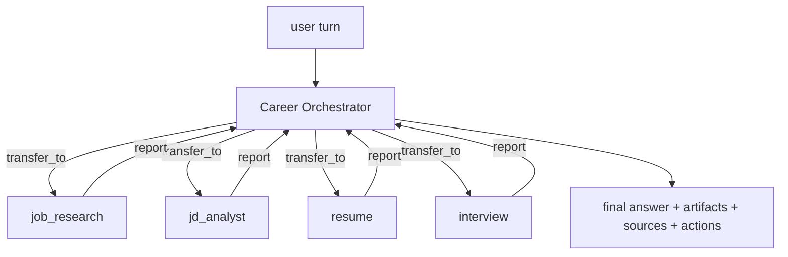

# Agents

How AI Career OS turns "call an LLM" into an inspectable agent system (PRD §16,
§17, §18, §31). Implementation: `ai-service/app/agents/`. Home-grown loop, no
orchestration framework — every stage is explicit code that emits trace events.

## 1. The orchestrator loop

`orchestrator.career_turn()` handles one user turn:

```
system prompt (+ long-term memory + pinned context)
  └─ conversation window (last 12 turns)
       └─ loop, max 8 steps:
            LLM decides: answer directly │ call a tool │ transfer_to(subagent)
            tool result → appended as a `tool` message → next step
       └─ budget exhausted → forced summarise call over collected tool output
```

Key properties:

- **Grounded by construction.** A tool result is always replayed back to the model
  as a `tool` message, so the final answer is written over real output rather than
  recalled knowledge. The system prompt forbids inventing experience, skills,
  companies or results.
- **Bounded.** `MAX_STEPS = 8` (subagents `MAX_SUB_STEPS = 5`) and a per-result
  character cap (`RESULT_CHARS = 6000`) keep a looping or over-eager model from
  burning the budget; exhausting the budget still yields a grounded summary.
- **Fault-tolerant.** A tool that raises or receives bad arguments becomes
  `{"error": ...}` in the transcript — the run continues and the model is expected
  to recover. Bad arguments from the model never crash the turn.
- **Side-effect aware.** `Outcome` collects `artifacts` (structured payloads the UI
  renders) and derives `actions` (suggested next steps: tailor / interview / cover
  letter / open job), so a chat turn produces a usable product surface, not just
  text.

Returned `Outcome`: `answer`, `artifacts[]`, `sources[]`, `actions[]`, `steps`,
`tools_used[]`, `run_id`.

## 2. Subagents and handoff

Seven subagents, each with its own system prompt, its **own whitelisted tool
surface**, and no ability to delegate further (no recursive handoff):

| Subagent | Tools |
|---|---|
| `resume` | `parse_resume`, `search_resume`, `generate_resume`, `generate_cover_letter`, `search_knowledge_base`, `get_user_profile` |
| `job_research` | `search_jobs`, `get_job`, `get_company`, `search_knowledge_base`, `get_user_profile` |
| `jd_analyst` | `analyze_jd`, `calculate_match`, `get_job`, `search_resume` |
| `rag` | `search_knowledge_base`, `search_resume` |
| `interview` | `create_interview`, `evaluate_answer`, `get_job`, `search_resume` |
| `learning` | `search_knowledge_base`, `get_user_profile`, `get_job` |
| `tracker` | `save_job`, `update_application_status`, `search_jobs`, `get_job` |

Handoff is an explicit tool, `transfer_to(agent, task)`, not a prompt trick. It is
recorded as a `handoff` trace event and streamed as a `status` step, so the UI can
show *"Delegating to job_research agent"*. The subagent returns a compact factual
report (ids, numbers, evidence refs); **the orchestrator stays responsible for the
final user-facing answer**, which keeps one voice and one citation discipline.



## 3. Memory (PRD §17)

- **Short-term** — the conversation window (last 12 turns, 4 000 chars each) passed
  in by the backend, plus `context` pins (a specific job/resume/conversation scope).
- **Long-term** — `user_memories` rows, grouped by kind (`profile`, `skill`,
  `preference`, `interview`, `goal`, `fact`). `memory.build_memory_context()` reads
  up to 40 and renders them as a `## Long-term memory about this user` section
  appended to the system prompt.
- **Write path** — after a successful turn, `memory.extract_and_store()` makes one
  cheap extraction call, keeps at most 4 durable facts with `len(content) >= 8` and
  a clamped importance score, and upserts them. It is best-effort: a failure logs a
  warning and never fails the user's turn. Credentials and secrets are explicitly
  out of scope.

## 4. Tool system (PRD §18)

15 tools in `agents/tools.py`, each a `Tool(name, description, JSON-Schema
parameters, async handler, artifact_type?, agent?)`. The schema is converted to the
provider's tool format via `Tool.spec()`, so one definition serves OpenAI-compatible
APIs, Anthropic and Ollama.

| Tool | Purpose | Artifact |
|---|---|---|
| `search_jobs` | keyword/skills/location/company/remote/salary search | `job_list` |
| `get_job` | job detail + cached match | |
| `get_company` | company intelligence + open roles | |
| `parse_resume` | raw text → structured profile + score | |
| `search_resume` | semantic search over resume/project chunks | |
| `search_knowledge_base` | hybrid RAG retrieval + context block | |
| `analyze_jd` | pasted JD → structured requirements | |
| `calculate_match` | deterministic, evidence-bound match score | `match` |
| `generate_resume` | no-fabrication tailoring + diff | `tailored_resume` |
| `generate_cover_letter` | personalized cover letter | `cover_letter` |
| `create_interview` | start a mock interview session | `interview_session` |
| `evaluate_answer` | grade one interview answer | |
| `save_job` | bookmark + create a `saved` application | |
| `update_application_status` | move an application through the pipeline | |
| `get_user_profile` | profile, goals, memories, resume headline | |

Tools read domain data directly from Postgres, always user-scoped (`user_id` on
every query) — the ownership exception documented in
[architecture.md](architecture.md) §9. Writes are deliberately minimal: `save_job`,
`update_application_status`, `create_interview` and the derived `job_matches` row.

## 5. Observability (PRD §31)

Every run is a row in `agent_runs` (agent, trigger, model, tokens, cached tokens,
cost, latency, status, error) with ordered `agent_traces` steps:

```
step_start → llm_call → tool_call → tool_result → … → handoff → final
             (retrieval / rerank are emitted by the RAG pipeline inside a tool)
```

Trace payloads carry the interesting detail — tool args, an ok/err flag and a
result preview, model + token counts + cost per LLM call, the handoff target and
brief, and the final step/tool/artifact summary. `ai_usage_events` records token
and cost per call for the dashboard's AI-usage panel.

**AI Activity UI**: `GET /api/v1/activity/runs` (list) and
`/api/v1/activity/runs/{id}` (run + traces) are proxied from the ai-service
endpoints above; the frontend renders them as a timeline
(`components/ai/agent-timeline.tsx`, `/activity` and `/activity/[id]`). This is
PRD §47 Demo 6 — you can open any run and see agent → tools → retrieval → sources
→ LLM → final answer.

**Streaming**: the copilot page posts to `POST /copilot/chat/stream` and reads the turn as an SSE
stream — `status` frames carrying the agent's own `{agent, step}` ("Thinking", "Calling
search_jobs"), `token` deltas (the chat task runs with `stream=True`, so `core/ai.py`'s per-call
`emit` publishes them), the task bus's `ping` keep-alive, and one terminal frame. The backend
half is `CopilotStreamService`: it starts the turn with `POST /internal/agents/chat`, consumes
`GET /internal/stream/{task_id}` through `SseRelayService.consume`, intercepts `done` and stores
both messages via `ConversationService.persistTurn` **on its own thread** — a tab closed mid-
answer does not lose the reply — then answers the browser with the same `ChatResponse` that
`POST /copilot/chat` returns. `error` frames pass through; a turn that ends without `done` is an
`error`, never a hang. `POST /internal/agents/chat/sync` and `/copilot/chat` remain the blocking
pair for scripts, the e2e suite and the eval harness, and the client falls back to them when the
stream route answers 404. The browser half is `postSSE` (`lib/api/client.ts`): `request()`'s auth
and one refresh-on-401, frames parsed and dispatched by `lib/sse/use-sse.ts`, resolving on `done`
and rejecting with `errorText`'s first line.

## 6. Correcting what the model remembers

Every memory in §3 was written by the model and read by the model, which left the user
outside the loop: `memory.extract_and_store` only ever *adds*, so a sentence the extractor
invented was quoted back as fact on every later turn with no way to say otherwise. `domain.list_memories`
returns the row's own id (the prompt reader `get_memories` stops at 20 and returns no id),
and three routes let a user act on it:

| Route | Body | Effect |
|---|---|---|
| `GET /internal/memories?kinds=a,b` | — | every memory, newest update first, capped by the caller |
| `PATCH /internal/memories/{id}` | `content` and/or `importance` | correct the text, or lower its weight |
| `DELETE /internal/memories/{id}` | — | forget it outright |

The two fields are patched independently because they are corrected independently: a wrong
fact needs its text fixed, a fact the user is tired of being reminded about only needs its
importance lowered. An empty `content` is a 400 — blank is what "forget this sentence" looks
like to a model that would just as happily store the empty string — so `DELETE` is the route
for that. All three scope `user_id` in the `WHERE`, so another user's id is a 404 rather than
a 403: "not yours" and "not there" are the same answer. `domain.update_memory` reads the row
back when nothing is being written, so a no-op patch is not a write.

Two paths also write there directly: `POST /internal/agents/chat` and `/chat/sync` extract
durable facts after a turn, and `/internal/interview/finalize` records the report's verdict
as an `interview` memory — the one §17 listed as a kind that nothing could produce.
