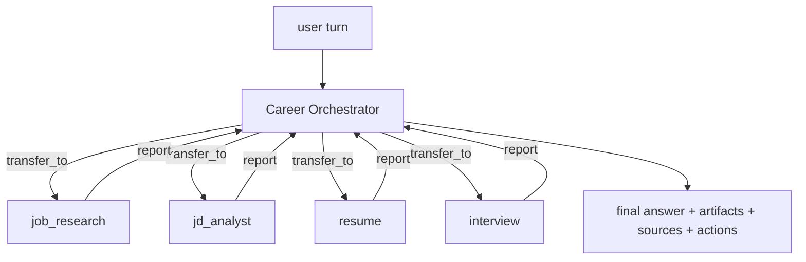

# Agents

How AI Career OS turns "call an LLM" into an inspectable agent system (PRD §16,
§17, §18, §31). Implementation: `ai-service/app/agents/`. Home-grown loop, no
orchestration framework — every stage is explicit code that emits trace events.

## 1. The orchestrator loop

`orchestrator.career_turn()` handles one user turn:

```
system prompt (+ long-term memory + pinned context)
  └─ conversation window (last 12 turns)
       └─ loop, max 8 steps:
            LLM decides: answer directly │ call a tool │ transfer_to(subagent)
            tool result → appended as a `tool` message → next step
       └─ budget exhausted → forced summarise call over collected tool output
```

Key properties:

- **Grounded by construction.** A tool result is always replayed back to the model
  as a `tool` message, so the final answer is written over real output rather than
  recalled knowledge. The system prompt forbids inventing experience, skills,
  companies or results.
- **Bounded.** `MAX_STEPS = 8` (subagents `MAX_SUB_STEPS = 5`) and a per-result
  character cap (`RESULT_CHARS = 6000`) keep a looping or over-eager model from
  burning the budget; exhausting the budget still yields a grounded summary.
- **Fault-tolerant.** A tool that raises or receives bad arguments becomes
  `{"error": ...}` in the transcript — the run continues and the model is expected
  to recover. Bad arguments from the model never crash the turn.
- **Side-effect aware.** `Outcome` collects `artifacts` (structured payloads the UI
  renders) and derives `actions` (suggested next steps: tailor / interview / cover
  letter / open job), so a chat turn produces a usable product surface, not just
  text.

Returned `Outcome`: `answer`, `artifacts[]`, `sources[]`, `actions[]`, `steps`,
`tools_used[]`, `run_id`.

## 2. Subagents and handoff

Eight subagents, each with its own system prompt, its **own whitelisted tool
surface**, and no ability to delegate further (no recursive handoff):

| Subagent | Tools |
|---|---|
| `resume` | `parse_resume`, `search_resume`, `generate_resume`, `generate_cover_letter`, `search_knowledge_base`, `get_user_profile` |
| `job_research` | `search_jobs`, `get_job`, `get_company`, `search_knowledge_base`, `get_user_profile` |
| `jd_analyst` | `analyze_jd`, `calculate_match`, `get_job`, `search_resume` |
| `rag` | `search_knowledge_base`, `search_resume` |
| `interview` | `create_interview`, `evaluate_answer`, `get_job`, `search_resume` |
| `learning` | `search_knowledge_base`, `get_user_profile`, `get_job`, `analyze_gap`, `benchmark_salary`, `compare_offers`, `learning_priority` |
| `tracker` | `save_job`, `update_application_status`, `search_jobs`, `get_job` |
| `networking` | `search_contacts`, `get_follow_ups`, `draft_outreach`, `log_contact_touch`, `get_user_profile` |

Handoff is an explicit tool, `transfer_to(agent, task)`, not a prompt trick. It is
recorded as a `handoff` trace event and streamed as a `status` step, so the UI can
show *"Delegating to job_research agent"*. The subagent returns a compact factual
report (ids, numbers, evidence refs); **the orchestrator stays responsible for the
final user-facing answer**, which keeps one voice and one citation discipline.



## 3. Memory (PRD §17)

- **Short-term** — the conversation window (last 12 turns, 4 000 chars each) passed
  in by the backend, plus `context` pins (a specific job/resume/conversation scope).
- **Long-term** — `user_memories` rows, grouped by kind (`profile`, `skill`,
  `preference`, `interview`, `goal`, `fact`). `memory.build_memory_context()` reads
  up to 40 and renders them as a `## Long-term memory about this user` section
  appended to the system prompt.
- **Write path** — after a successful turn, `memory.extract_and_store()` makes one
  cheap extraction call, keeps at most 4 durable facts with `len(content) >= 8` and
  a clamped importance score, and upserts them. It is best-effort: a failure logs a
  warning and never fails the user's turn. Credentials and secrets are explicitly
  out of scope.

## 4. Tool system (PRD §18)

23 tools in `agents/tools.py`, each a `Tool(name, description, JSON-Schema
parameters, async handler, artifact_type?, agent?)`. The schema is converted to the
provider's tool format via `Tool.spec()`, so one definition serves OpenAI-compatible
APIs, Anthropic and Ollama.

| Tool | Purpose | Artifact |
|---|---|---|
| `search_jobs` | keyword/skills/location/company/remote/salary search | `job_list` |
| `get_job` | job detail + cached match | |
| `get_company` | company intelligence + open roles | |
| `parse_resume` | raw text → structured profile + score | |
| `search_resume` | semantic search over resume/project chunks | |
| `search_knowledge_base` | hybrid RAG retrieval + context block | |
| `analyze_jd` | pasted JD → structured requirements | |
| `calculate_match` | deterministic, evidence-bound match score | `match` |
| `generate_resume` | no-fabrication tailoring + diff | `tailored_resume` |
| `generate_cover_letter` | personalized cover letter | `cover_letter` |
| `create_interview` | start a mock interview session | `interview_session` |
| `evaluate_answer` | grade one interview answer | |
| `save_job` | bookmark + create a `saved` application | |
| `update_application_status` | move an application through the pipeline | |
| `get_user_profile` | profile, goals, memories, resume headline | |
| `search_contacts` | the user's saved contacts by name/company/relation | |
| `get_follow_ups` | contacts gone cold against their relation's cadence, with drafts | |
| `draft_outreach` | referral/intro/coffee-chat/thank-you message for a saved contact | |
| `log_contact_touch` | stamp a contact as touched now, optionally with a note | |
| `analyze_gap` | the distance between the profile and a target role | `gap_report` |
| `benchmark_salary` | what the job corpus pays for a role, by band and location | `salary_band` |
| `compare_offers` | several offers ranked against the market by total compensation | `offer_comparison` |
| `learning_priority` | the gaps ranked by importance and by market pull | `learning_priority` |

Tools read domain data directly from Postgres, always user-scoped (`user_id` on
every query) — the ownership exception documented in
[architecture.md](architecture.md) §9. Writes are deliberately minimal: `save_job`,
`update_application_status`, `create_interview`, `log_contact_touch` and the derived
`job_matches` row.

## 5. Observability (PRD §31)

Every run is a row in `agent_runs` (agent, trigger, model, tokens, cached tokens,
cost, latency, status, error) with ordered `agent_traces` steps:

```
step_start → llm_call → tool_call → tool_result → … → handoff → final
             (retrieval / rerank are emitted by the RAG pipeline inside a tool)
```

Trace payloads carry the interesting detail — tool args, an ok/err flag and a
result preview, model + token counts + cost per LLM call, the handoff target and
brief, and the final step/tool/artifact summary. `ai_usage_events` records token
and cost per call for the dashboard's AI-usage panel.

**AI Activity UI**: `GET /api/v1/activity/runs` (list) and
`/api/v1/activity/runs/{id}` (run + traces) are not an ai-service call. ai-service
writes `agent_runs`/`agent_traces` (`app/db/observability.py`); `ActivityController`
reads those same rows back through `AgentRunRepository`/`AgentTraceRepository`, scoped
by the caller's `user.id()`. There is no HTTP hop, so the panel keeps serving run
history while ai-service is down — and the two ai-service reads of the same rows,
`GET /internal/agents/runs` and `GET /internal/agents/runs/{run_id}`, are exactly the
routes section 3 of [API.md](API.md) marks "no backend caller". The frontend renders
them as a timeline (`components/ai/agent-timeline.tsx`, `/activity` and
`/activity/[id]`). This is PRD §47 Demo 6 — you can open any run and see agent → tools
→ retrieval → sources → LLM → final answer.

**Streaming**: the copilot page posts to `POST /copilot/chat/stream` and reads the turn as an SSE
stream — `status` frames carrying the agent's own `{agent, step}` ("Thinking", "Calling
search_jobs"), `token` deltas (the chat task runs with `stream=True`, so `core/ai.py`'s per-call
`emit` publishes them), the task bus's `ping` keep-alive, and one terminal frame. The backend
half is `CopilotStreamService`: it starts the turn with `POST /internal/agents/chat`, consumes
`GET /internal/stream/{task_id}` through `SseRelayService.consume`, intercepts `done` and stores
both messages via `ConversationService.persistTurn` **on its own thread** — a tab closed mid-
answer does not lose the reply — then answers the browser with the same `ChatResponse` that
`POST /copilot/chat` returns. `error` frames pass through; a turn that ends without `done` is an
`error`, never a hang. `POST /internal/agents/chat/sync` and `/copilot/chat` remain the blocking
pair for scripts, the e2e suite and the eval harness, and the client falls back to them when the
stream route answers 404. The browser half is `postSSE` (`lib/api/client.ts`): `request()`'s auth
and one refresh-on-401, frames parsed and dispatched by `lib/sse/use-sse.ts`, resolving on `done`
and rejecting with `errorText`'s first line.

**The async dispatch has to be permitted.** The security chain runs *again* when the emitter is
written to, and the session is stateless, so the security context is gone by then and
`anyRequest().authenticated()` denies the dispatch. The response headers have already gone out,
so the browser sees a 200 and an event stream that never carries an event. Nothing looks broken:
the client falls back to the blocking pair, the turn still happens, the answer still appears and
the run is still recorded and billed — the screen is perfect and nothing is ever streamed.
`SecurityConfig` therefore permits the `ASYNC` and `ERROR` dispatchers: an async dispatch is the
continuation of a request that was already authorized, so the original dispatch is where the
authorization belongs. The end-to-end suite holds it by wrapping the page's own `fetch` and
reading the clone of the streaming response — the bytes the browser received — because a turn
that is *answered* and a turn that is *streamed* look identical on the screen.

## 6. Correcting what the model remembers

Every memory in §3 was written by the model and read by the model, which left the user
outside the loop: `memory.extract_and_store` only ever *adds*, so a sentence the extractor
invented was quoted back as fact on every later turn with no way to say otherwise. `domain.list_memories`
returns the row's own id (the prompt reader `get_memories` stops at 20 and returns no id),
and three routes let a user act on it:

| Route | Body | Effect |
|---|---|---|
| `GET /internal/memories?kinds=a,b` | — | every memory, newest update first, capped by the caller |
| `PATCH /internal/memories/{id}` | `content` and/or `importance` | correct the text, or lower its weight |
| `DELETE /internal/memories/{id}` | — | forget it outright |

The two fields are patched independently because they are corrected independently: a wrong
fact needs its text fixed, a fact the user is tired of being reminded about only needs its
importance lowered. An empty `content` is a 400 — blank is what "forget this sentence" looks
like to a model that would just as happily store the empty string — so `DELETE` is the route
for that. All three scope `user_id` in the `WHERE`, so another user's id is a 404 rather than
a 403: "not yours" and "not there" are the same answer. `domain.update_memory` reads the row
back when nothing is being written, so a no-op patch is not a write.

Two paths also write there directly: `POST /internal/agents/chat` and `/chat/sync` extract
durable facts after a turn, and `/internal/interview/finalize` records the report's verdict
as an `interview` memory — the one §17 listed as a kind that nothing could produce.

## 7. The deterministic engines (Epics 10-16)

Everything in §1-§4 is a *model* call, and everything in §7 is not. The engines in
`app/features/` are pure functions over the user's own data — the resume, the
application rows, the seeded job corpus — so a question they answer has one right
answer and no reason to spend a token on it.

They reached the browser in two steps, and the second one is what this section is
about. Each engine shipped first as an internal route with no caller (the forward
surface), and each was later bridged: a `HttpAiServiceClient` method, a backend
route, a frontend surface. The bridge owns none of the logic — it reads the caller's
rows, forwards the request, and answers the engine's own shape. A second copy of the
arithmetic on the backend side would be a second answer to the same question.

| Epic | The engine answers | Backend route |
|---|---|---|
| 10.1-10.13 | gap, readiness, learning plan, skill demand, learning priority, progression, interview prep, story bank, role suggestions, progress | `POST /api/v1/growth/*` |
| 11.2-11.3 | the outreach draft; the contacts gone cold | `POST /api/v1/outreach/draft`; the dashboard's `followUps` |
| 12.1-12.5 | salary benchmark, negotiation coach, offer comparison, counter-offer | `POST /api/v1/offers/*` |
| 13.1-13.3 | the export bundle, the import plan, section redaction | `POST /api/v1/data-portability/*` |
| 14.2-14.3 | feed parsing, de-duplication, the freshness sweep, the ingest plan | `POST /api/v1/jobs/ingest/*` |
| 15.1-15.3 | the pipeline funnel, the response rate, the insight digest | `GET /api/v1/analysis/*` |
| 16.1-16.2 | the health report, the rate-limit status | `GET /api/v1/monitoring/health-report`; `GET /api/v1/rate-limit/status` |

Three properties hold across every one of them, and the census gates
(`test_internal_contract.py`, `test_api_doc_contract.py`) charge each:

- **The user's rows travel under the engine's own field names.** The digest reads
  `applied_at` and `created_at`; a row sent under a Java column name is a row the
  engine sees as a title and nothing else.
- **Only the fields the engine binds are sent.** A key the endpoint's model does
  not declare is a key Jackson drops, and a dropped key is a request that says more
  than it asks.
- **The caller's id travels with the request.** The ingestion engines write rows;
  a sweep that ran under a random id would put another user's jobs in this one's
  board.

## 8. The four quiet failures

Four bugs in this repository looked like working code and were not. They are
written down because each one is a *shape* of failure, not a one-off: the next
one will have the same shape, and the gate that catches it is the thing to
reach for.

**A live collection, read after it was cleared.** A `FileList` is a view of
the input's own selection, so clearing the input empties it. The knowledge
base's uploader cleared the input — so that re-picking the same files starts
a fresh batch — and it did that *before* reading them, which handed the
batch an empty list. An empty list is not an error: it is a batch of
nothing. The panel showed no row, the request never went out, and the reader
was told nothing at all. The uploader had never uploaded anything. The copy
of the collection has to be taken **before** the thing that empties it, and
the order is the whole bug.

**A word the reader cannot change, written where the gate cannot look.** The
copy census walked a `.tsx` file's copy-bearing attributes and the text
between the tags. It did not read an object literal — and half the
product's copy is written as one. A bar labelled "Technical" on a Chinese
page was exactly as invisible to the gate as an attribute was, and it was
exactly as wrong. A gate measures the population it can see; a hole in the
scan is a hole in the product. `lib/i18n/copy-scan.ts` now reads the three
shapes the copy is actually written in, and `scripts/regen-known.mjs` uses
*that* scan, so the list the gate measures and the list the tool
regenerates cannot drift apart.

**A title set on the client, undone by the framework.** A `useEffect` that
writes `document.title` runs, and the title does change, and then React's own
metadata reconciliation resets it — the `<title>` element is part of the tree
it just hydrated. The write is undone a moment after it happens. The title
is rendered into the head the browser paints *before any script runs*, and
that head is what a crawler reads, so the only place a title can be right is
the server's answer. The locale therefore travels in a cookie as well as in
`localStorage`, and the server reads it (`lib/i18n/metadata.ts`).

**A gate that measures the wrong population.** The census's own rule caught
a TypeScript type: `type SearchFn = (q: string) => Promise<SearchResults>`
has a `>` in it, and the scan read the text after it as a text node. So
`Promise` was in the list of words the reader cannot change — and no edit to
the source could ever have removed it, because the source was correct. A
gate with a false positive trains people to ignore it, and a gate that
ignores the difference between a *word* and a *type* stops being a census.
The scan's anchor is now a `>` that is not an arrow's.

Each of these has a gate now, and each gate is a *different kind* of
check: an order (the copy before the clear), a population (the three
shapes of copy), a mechanism (the server's answer, not the client's), and
the scan's own rule (an anchor that is not a type). The general shape is
the same in all four: **the bug was where nobody was looking, and the
answer was to look there, not to look harder.**
