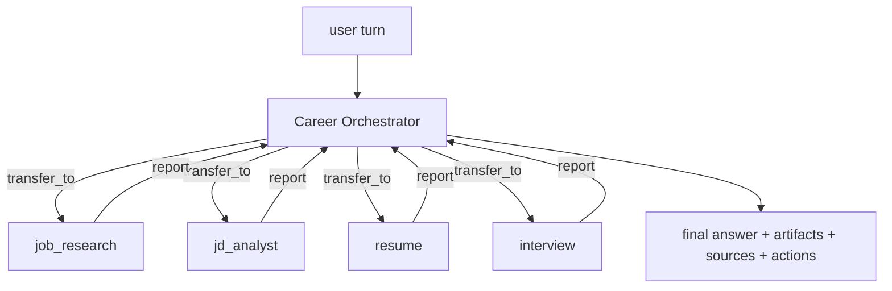

# Agents

How AI Career OS turns "call an LLM" into an inspectable agent system (PRD §16,
§17, §18, §31). Implementation: `ai-service/app/agents/`. Home-grown loop, no
orchestration framework — every stage is explicit code that emits trace events.

## 1. The orchestrator loop

`orchestrator.career_turn()` handles one user turn:

```
system prompt (+ long-term memory + pinned context)
  └─ conversation window (last 12 turns)
       └─ loop, max 8 steps:
            LLM decides: answer directly │ call a tool │ transfer_to(subagent)
            tool result → appended as a `tool` message → next step
       └─ budget exhausted → forced summarise call over collected tool output
```

Key properties:

- **Grounded by construction.** A tool result is always replayed back to the model
  as a `tool` message, so the final answer is written over real output rather than
  recalled knowledge. The system prompt forbids inventing experience, skills,
  companies or results.
- **Bounded.** `MAX_STEPS = 8` (subagents `MAX_SUB_STEPS = 5`) and a per-result
  character cap (`RESULT_CHARS = 6000`) keep a looping or over-eager model from
  burning the budget; exhausting the budget still yields a grounded summary.
- **Fault-tolerant.** A tool that raises or receives bad arguments becomes
  `{"error": ...}` in the transcript — the run continues and the model is expected
  to recover. Bad arguments from the model never crash the turn.
- **Side-effect aware.** `Outcome` collects `artifacts` (structured payloads the UI
  renders) and derives `actions` (suggested next steps: tailor / interview / cover
  letter / open job), so a chat turn produces a usable product surface, not just
  text.

Returned `Outcome`: `answer`, `artifacts[]`, `sources[]`, `actions[]`, `steps`,
`tools_used[]`, `run_id`.

## 2. Subagents and handoff

Eight subagents, each with its own system prompt, its **own whitelisted tool
surface**, and no ability to delegate further (no recursive handoff):

| Subagent | Tools |
|---|---|
| `resume` | `parse_resume`, `search_resume`, `generate_resume`, `generate_cover_letter`, `search_knowledge_base`, `get_user_profile` |
| `job_research` | `search_jobs`, `get_job`, `get_company`, `search_knowledge_base`, `get_user_profile` |
| `jd_analyst` | `analyze_jd`, `calculate_match`, `get_job`, `search_resume` |
| `rag` | `search_knowledge_base`, `search_resume` |
| `interview` | `create_interview`, `evaluate_answer`, `get_job`, `search_resume` |
| `learning` | `search_knowledge_base`, `get_user_profile`, `get_job`, `analyze_gap`, `benchmark_salary`, `compare_offers`, `learning_priority` |
| `tracker` | `save_job`, `update_application_status`, `search_jobs`, `get_job` |
| `networking` | `search_contacts`, `get_follow_ups`, `draft_outreach`, `log_contact_touch`, `get_user_profile` |

Handoff is an explicit tool, `transfer_to(agent, task)`, not a prompt trick. It is
recorded as a `handoff` trace event and streamed as a `status` step, so the UI can
show *"Delegating to job_research agent"*. The subagent returns a compact factual
report (ids, numbers, evidence refs); **the orchestrator stays responsible for the
final user-facing answer**, which keeps one voice and one citation discipline.



## 3. Memory (PRD §17)

- **Short-term** — the conversation window (last 12 turns, 4 000 chars each) passed
  in by the backend, plus `context` pins (a specific job/resume/conversation scope).
- **Long-term** — `user_memories` rows, grouped by kind (`profile`, `skill`,
  `preference`, `interview`, `goal`, `fact`). `memory.build_memory_context()` reads
  up to 40 and renders them as a `## Long-term memory about this user` section
  appended to the system prompt.
- **Write path** — after a successful turn, `memory.extract_and_store()` makes one
  cheap extraction call, keeps at most 4 durable facts with `len(content) >= 8` and
  a clamped importance score, and upserts them. It is best-effort: a failure logs a
  warning and never fails the user's turn. Credentials and secrets are explicitly
  out of scope.

## 4. Tool system (PRD §18)

23 tools in `agents/tools.py`, each a `Tool(name, description, JSON-Schema
parameters, async handler, artifact_type?, agent?)`. The schema is converted to the
provider's tool format via `Tool.spec()`, so one definition serves OpenAI-compatible
APIs, Anthropic and Ollama.

| Tool | Purpose | Artifact |
|---|---|---|
| `search_jobs` | keyword/skills/location/company/remote/salary search | `job_list` |
| `get_job` | job detail + cached match | |
| `get_company` | company intelligence + open roles | |
| `parse_resume` | raw text → structured profile + score | |
| `search_resume` | semantic search over resume/project chunks | |
| `search_knowledge_base` | hybrid RAG retrieval + context block | |
| `analyze_jd` | pasted JD → structured requirements | |
| `calculate_match` | deterministic, evidence-bound match score | `match` |
| `generate_resume` | no-fabrication tailoring + diff | `tailored_resume` |
| `generate_cover_letter` | personalized cover letter | `cover_letter` |
| `create_interview` | start a mock interview session | `interview_session` |
| `evaluate_answer` | grade one interview answer | |
| `save_job` | bookmark + create a `saved` application | |
| `update_application_status` | move an application through the pipeline | |
| `get_user_profile` | profile, goals, memories, resume headline | |
| `search_contacts` | the user's saved contacts by name/company/relation | |
| `get_follow_ups` | contacts gone cold against their relation's cadence, with drafts | |
| `draft_outreach` | referral/intro/coffee-chat/thank-you message for a saved contact | |
| `log_contact_touch` | stamp a contact as touched now, optionally with a note | |
| `analyze_gap` | the distance between the profile and a target role | `gap_report` |
| `benchmark_salary` | what the job corpus pays for a role, by band and location | `salary_band` |
| `compare_offers` | several offers ranked against the market by total compensation | `offer_comparison` |
| `learning_priority` | the gaps ranked by importance and by market pull | `learning_priority` |

Tools read domain data directly from Postgres, always user-scoped (`user_id` on
every query) — the ownership exception documented in
[architecture.md](architecture.md) §9. Writes are deliberately minimal: `save_job`,
`update_application_status`, `create_interview`, `log_contact_touch` and the derived
`job_matches` row.

## 5. Observability (PRD §31)

Every run is a row in `agent_runs` (agent, trigger, model, tokens, cached tokens,
cost, latency, status, error) with ordered `agent_traces` steps:

```
step_start → llm_call → tool_call → tool_result → … → handoff → final
             (retrieval / rerank are emitted by the RAG pipeline inside a tool)
```

Trace payloads carry the interesting detail — tool args, an ok/err flag and a
result preview, model + token counts + cost per LLM call, the handoff target and
brief, and the final step/tool/artifact summary. `ai_usage_events` records token
and cost per call for the dashboard's AI-usage panel.

**AI Activity UI**: `GET /api/v1/activity/runs` (list) and
`/api/v1/activity/runs/{id}` (run + traces) are not an ai-service call. ai-service
writes `agent_runs`/`agent_traces` (`app/db/observability.py`); `ActivityController`
reads those same rows back through `AgentRunRepository`/`AgentTraceRepository`, scoped
by the caller's `user.id()`. There is no HTTP hop, so the panel keeps serving run
history while ai-service is down — and the two ai-service reads of the same rows,
`GET /internal/agents/runs` and `GET /internal/agents/runs/{run_id}`, are exactly the
routes section 3 of [API.md](API.md) marks "no backend caller". The frontend renders
them as a timeline (`components/ai/agent-timeline.tsx`, `/activity` and
`/activity/[id]`). This is PRD §47 Demo 6 — you can open any run and see agent → tools
→ retrieval → sources → LLM → final answer.

**Streaming**: the copilot page posts to `POST /copilot/chat/stream` and reads the turn as an SSE
stream — `status` frames carrying the agent's own `{agent, step}` ("Thinking", "Calling
search_jobs"), `token` deltas (the chat task runs with `stream=True`, so `core/ai.py`'s per-call
`emit` publishes them), the task bus's `ping` keep-alive, and one terminal frame. The backend
half is `CopilotStreamService`: it starts the turn with `POST /internal/agents/chat`, consumes
`GET /internal/stream/{task_id}` through `SseRelayService.consume`, intercepts `done` and stores
both messages via `ConversationService.persistTurn` **on its own thread** — a tab closed mid-
answer does not lose the reply — then answers the browser with the same `ChatResponse` that
`POST /copilot/chat` returns. `error` frames pass through; a turn that ends without `done` is an
`error`, never a hang. `POST /internal/agents/chat/sync` and `/copilot/chat` remain the blocking
pair for scripts, the e2e suite and the eval harness, and the client falls back to them when the
stream route answers 404. The browser half is `postSSE` (`lib/api/client.ts`): `request()`'s auth
and one refresh-on-401, frames parsed and dispatched by `lib/sse/use-sse.ts`, resolving on `done`
and rejecting with `errorText`'s first line.

**The async dispatch has to be permitted.** The security chain runs *again* when the emitter is
written to, and the session is stateless, so the security context is gone by then and
`anyRequest().authenticated()` denies the dispatch. The response headers have already gone out,
so the browser sees a 200 and an event stream that never carries an event. Nothing looks broken:
the client falls back to the blocking pair, the turn still happens, the answer still appears and
the run is still recorded and billed — the screen is perfect and nothing is ever streamed.
`SecurityConfig` therefore permits the `ASYNC` and `ERROR` dispatchers: an async dispatch is the
continuation of a request that was already authorized, so the original dispatch is where the
authorization belongs. The end-to-end suite holds it by wrapping the page's own `fetch` and
reading the clone of the streaming response — the bytes the browser received — because a turn
that is *answered* and a turn that is *streamed* look identical on the screen.

## 6. Correcting what the model remembers

Every memory in §3 was written by the model and read by the model, which left the user
outside the loop: `memory.extract_and_store` only ever *adds*, so a sentence the extractor
invented was quoted back as fact on every later turn with no way to say otherwise. `domain.list_memories`
returns the row's own id (the prompt reader `get_memories` stops at 20 and returns no id),
and three routes let a user act on it:

| Route | Body | Effect |
|---|---|---|
| `GET /internal/memories?kinds=a,b` | — | every memory, newest update first, capped by the caller |
| `PATCH /internal/memories/{id}` | `content` and/or `importance` | correct the text, or lower its weight |
| `DELETE /internal/memories/{id}` | — | forget it outright |

The two fields are patched independently because they are corrected independently: a wrong
fact needs its text fixed, a fact the user is tired of being reminded about only needs its
importance lowered. An empty `content` is a 400 — blank is what "forget this sentence" looks
like to a model that would just as happily store the empty string — so `DELETE` is the route
for that. All three scope `user_id` in the `WHERE`, so another user's id is a 404 rather than
a 403: "not yours" and "not there" are the same answer. `domain.update_memory` reads the row
back when nothing is being written, so a no-op patch is not a write.

Two paths also write there directly: `POST /internal/agents/chat` and `/chat/sync` extract
durable facts after a turn, and `/internal/interview/finalize` records the report's verdict
as an `interview` memory — the one §17 listed as a kind that nothing could produce.

## 7. The deterministic engines (Epics 10-16)

Everything in §1-§4 is a *model* call, and everything in §7 is not. The engines in
`app/features/` are pure functions over the user's own data — the resume, the
application rows, the seeded job corpus — so a question they answer has one right
answer and no reason to spend a token on it.

They reached the browser in two steps, and the second one is what this section is
about. Each engine shipped first as an internal route with no caller (the forward
surface), and each was later bridged: a `HttpAiServiceClient` method, a backend
route, a frontend surface. The bridge owns none of the logic — it reads the caller's
rows, forwards the request, and answers the engine's own shape. A second copy of the
arithmetic on the backend side would be a second answer to the same question.

| Epic | The engine answers | Backend route |
|---|---|---|
| 10.1-10.13 | gap, readiness, learning plan, skill demand, learning priority, progression, interview prep, story bank, role suggestions, progress | `POST /api/v1/growth/*` |
| 11.2-11.3 | the outreach draft; the contacts gone cold | `POST /api/v1/outreach/draft`; the dashboard's `followUps` |
| 12.1-12.5 | salary benchmark, negotiation coach, offer comparison, counter-offer | `POST /api/v1/offers/*` |
| 13.1-13.3 | the export bundle, the import plan, section redaction | `POST /api/v1/data-portability/*` |
| 14.2-14.3 | feed parsing, de-duplication, the freshness sweep, the ingest plan | `POST /api/v1/jobs/ingest/*` |
| 15.1-15.3 | the pipeline funnel, the response rate, the insight digest | `GET /api/v1/analysis/*` |
| 16.1-16.2 | the health report, the rate-limit status | `GET /api/v1/monitoring/health-report`; `GET /api/v1/rate-limit/status` |

Three properties hold across every one of them, and the census gates
(`test_internal_contract.py`, `test_api_doc_contract.py`) charge each:

- **The user's rows travel under the engine's own field names.** The digest reads
  `applied_at` and `created_at`; a row sent under a Java column name is a row the
  engine sees as a title and nothing else.
- **Only the fields the engine binds are sent.** A key the endpoint's model does
  not declare is a key Jackson drops, and a dropped key is a request that says more
  than it asks.
- **The caller's id travels with the request.** The ingestion engines write rows;
  a sweep that ran under a random id would put another user's jobs in this one's
  board.

## 8. The thirteen quiet failures

Thirteen bugs in this repository looked like working code and were not. They
are written down because each one is a *shape* of failure, not a one-off: the
next one will have the same shape, and the gate that catches it is the thing to
reach for.

**A live collection, read after it was cleared.** A `FileList` is a view of
the input's own selection, so clearing the input empties it. The knowledge
base's uploader cleared the input — so that re-picking the same files starts
a fresh batch — and it did that *before* reading them, which handed the
batch an empty list. An empty list is not an error: it is a batch of
nothing. The panel showed no row, the request never went out, and the reader
was told nothing at all. The uploader had never uploaded anything. The copy
of the collection has to be taken **before** the thing that empties it, and
the order is the whole bug.

**A word the reader cannot change, written where the gate cannot look.** The
copy census walked a `.tsx` file's copy-bearing attributes and the text
between the tags. It did not read an object literal — and half the
product's copy is written as one. A bar labelled "Technical" on a Chinese
page was exactly as invisible to the gate as an attribute was, and it was
exactly as wrong. A gate measures the population it can see; a hole in the
scan is a hole in the product. `lib/i18n/copy-scan.ts` now reads the three
shapes the copy is actually written in, and `scripts/regen-known.mjs` uses
*that* scan, so the list the gate measures and the list the tool
regenerates cannot drift apart.

**A title set on the client, undone by the framework.** A `useEffect` that
writes `document.title` runs, and the title does change, and then React's own
metadata reconciliation resets it — the `<title>` element is part of the tree
it just hydrated. The write is undone a moment after it happens. The title
is rendered into the head the browser paints *before any script runs*, and
that head is what a crawler reads, so the only place a title can be right is
the server's answer. The locale therefore travels in a cookie as well as in
`localStorage`, and the server reads it (`lib/i18n/metadata.ts`).

**A gate that measures the wrong population.** The census's own rule caught
a TypeScript type: `type SearchFn = (q: string) => Promise<SearchResults>`
has a `>` in it, and the scan read the text after it as a text node. So
`Promise` was in the list of words the reader cannot change — and no edit to
the source could ever have removed it, because the source was correct. A
gate with a false positive trains people to ignore it, and a gate that
ignores the difference between a *word* and a *type* stops being a census.
The scan's anchor is now a `>` that is not an arrow's.

**A file nobody could open.** The redaction removes a section from the export
bundle; the validator requires every section; so the file the reader
deliberately made shareable was rejected by the product's *own* restore path —
"missing data section: knowledge". The screen's copy had promised "the bundle
stays valid". And nothing was broken locally: the hash was recomputed over the
new data, the section was gone, the manifest named what went. Three functions
were each right about their own contract, and together they produced a file
that failed the fourth check. The manifest made it worse — it kept counting
the dropped rows, so the badge under the hash read "knowledge: 1" right after
the reader asked for the knowledge to be gone. **A feature's output has to be
checked against the thing that reads it**, and a summary is a claim about the
thing it summarizes, so it is checked by being recomputed from it. The
redaction's output is a bundle; the thing that reads a bundle is the import
path — and the import path is what the reader redacted the bundle *for*.

**A vocabulary the reader never sees.** The navigation table pairs an
English label with the key that translates it, and the key was *optional* — so
two items had none, and rendered their English names on every language. There
was a gate for it, and the gate's own comment said what it was for: "the
sidebar reads the label through a key, so a nav item without one silently keeps
its English name on a Chinese page." It checked the other direction. It walked
the translation *table's* keys and asked whether each had a Chinese label; it
never walked the *items* and asked whether each had a key at all. A table key
nobody asks for is dead weight; a nav item that asks for nothing is a page the
reader sees in English — and only the second one is a bug. The copy census
could not see it either: the navigation is a `.ts` module, and the census reads
`.tsx`. So the fix was to make the key **required**, which puts the check in
the type checker where it cannot be forgotten, and to turn the gate around to
the direction it had always claimed. **A gate that says what it is for has to
measure that thing, not the nearest thing it can measure** — and a fallback
table is exactly where a required field earns its keep.

The same table held the second line of the command palette's row — the
sentence that says what a page is *for* — as a plain English string with no key
at all, and the palette's own search matched that English, so a Chinese reader
typing the Chinese sentence for a page found nothing. Eighteen rows, one
vocabulary, and the same hole: a table of fallbacks is a vocabulary, and a
vocabulary is a table the census does not reach, so nothing in the repository
could see it until the palette's rows were measured off the screen and compared
across the two languages.

Each of these has a gate now, and each gate is a *different kind* of
check: an order (the copy before the clear), a population (the three
shapes of copy), a mechanism (the server's answer, not the client's), the
scan's own rule (an anchor that is not a type), a round trip (the
redacted file, read back by the path it exists for), a direction (the
navigation *items*, not the table's keys), an ownership (the restore
writes only the caller's rows), a path (the anonymized export, built
the way the button builds it), a route (the render, called the way
the bridge calls it), a place (the language, read where the
sentence is raised), a promise (a note, quoted by the agents the copy
says quotes it), a classification (every exported column, the
reader's or the substance), and a meaning (every error code, one
meaning or a named gap). The general shape is the same in all thirteen:
**the bug was where nobody was looking, and the answer was to look there,
not to look harder.**

**A promise the copy makes and the code does not keep.** The notes panel
says it three times over: the content field says "the agents can quote
this back with a citation", the section says "short reference notes the
agents can quote back at you", and deleting a note says "the note row is
removed and its chunks stop being cited".

Two of the three were true and the first was not. A note was a row in
`user_notes` and nothing else. Retrieval admits a chunk only while its
document row reads 'ready', and a note that was never ingested has no
document and no chunk -- so no agent could ever quote it. The delete path
was written for a note that *had* an embedded copy: it retires the note's
source by kind and reference, which is a retire of nothing.

The feature was half-built, and the half that was missing was the half the
copy is about. The note is ingested now, with the kind and the reference
that make the copy quotable and retirable, and an edit retires the old
copy before the new one lands -- the reader deleted a sentence and the
assistant kept quoting it.

**The shape is a promise nobody checked.** Three copies of copy, a delete
path written for chunks that were never created, and a test named
`deletingANoteRetiresItsEmbeddedCopy` that retired an embedded copy which
did not exist. Everything read as working code, because every part of it
was a part of the design -- just not the part that made the design true.

**And the same shape was true of the resume.** The knowledge page says "your
resume, projects and notes become a searchable, cited evidence layer", and a
resume the reader *uploaded* was in it -- there the file is the document, and
the document is chunked and embedded. A resume the reader *typed* was a row
in the resume list and nowhere else: no source, no chunk, nothing an agent
could cite. The restore path said so in a comment -- "the two steps a new
resume takes: the row, then the ingestion" -- and the API's own create path
did the first one and stopped.

So the ingestion moved into the create, where the restore's own comment said
it belonged, and the copy follows the *current version*: a reader who
switches versions has moved on from the text the copy carries, and an
assistant that keeps quoting the old one quotes a resume the reader no
longer has. The restore's own second step went away with it -- it made a
copy with no reference, so a restored resume's copy outlived the row it was
made from and kept being quoted after the resume was gone.

**A code that answers with several sentences.** The contract says "never
rename an emitted code", and the code is what crosses the wire — so the
sentence comes from the code, and the reader sees it in their language. That
is only true if the code means one thing, and it does not: `RESUME_NOT_FOUND`
answers with six different sentences, `BAD_REQUEST` with eleven,
`TOKEN_INVALID` with five. One sentence per code would tell a reader whose
resume exists but has no parsed version that "that resume is no longer there"
— a sentence that is wrong about most of the cases it covers.

Nothing measured that. The policy was a list of field names, and a list of
names says nothing about how many meanings sit behind them. So the codes the
browser raises itself were translated (the stream that ended early, the
upload the reader cancelled, the session that expired), and the services'
codes were left in English wholesale — including the twenty-three that mean
exactly one thing and could have been bilingual all along.

The gate now *measures* the split instead of remembering it: a translated
code must carry one meaning, a code named as a gap must carry several, and a
code nobody classified fails the gate — so a new code has to be one or the
other, and the gap list is the queue rather than an excuse. The sentence
comes from the code where the code is fine enough to carry it, and the
server's own words stay where it is not.

**A sentence raised where the language is not.** A failure toast is raised
from an event handler, long after the render that knew the reader's
language — and the sentence in it was an English literal. Every other word
in the product is read through the locale; this one could not be, because
the place it is raised has no language to read. So the browser's own
failures — the stream that ended early, the upload the reader cancelled,
the session that expired — were English on every language, and the
mechanism that would fix it did not exist.

**A place that cannot hold a language needs one.** The locale is global
anyway (a cookie and a `localStorage` entry), so reading it outside React
is not a second source of truth: it is the same one, read at the moment
the sentence is needed. The failures the *browser* raises now have
sentences in both languages, and the failure helper shows the table's
sentence rather than the English literal the code was raised with. The
services' own codes are not in the table yet, and that is a decision
rather than an oversight: their wording is more specific than one
sentence per code can be, and a generic sentence in place of "Start the
interview with an opening question first" would be a loss.

**A route nothing ever called.** "Print view" on the export page has never
worked. The render module was written, and the route that serves it was
written, and the route *referenced* the module — but nothing ever imported
it, so every call raised a `NameError`, the bridge turned it into a 502,
and the reader's only sign was an error toast. The unit tests called the
*function*; nothing called the *route*.

It is the same shape as the copy census: **the thing that was tested and the
thing the reader touches are not the same thing.** A function can be perfect
and the route that serves it can be broken, and only calling the route the
way the bridge calls it says which of the two is true.

**And the document was in one language, and missing two sections.** The
readable half of the export — the print-ready document — was written in
Chinese and had no other language, so an English reader's printable document
was a Chinese document; and the words live in a server-side module, in a
document, so the copy census could not see them either. The document also
left out the notes the reader typed and the people they know, so a section
the bundle carried was a section the reader could not read. The words now
live in one table, in every language the readable half ships in, and the
request says which one the reader wants — because the bundle carries the
data and the view carries the words.

**A flag that set a marker and nothing else.** "Export anonymized" is the
button a reader presses when the file is going to somebody else, and the
docs call the surface "the right-to-be-forgotten surface". The flag
travelled the whole way — browser, bridge, ai-service — and set two
markers: `user.anonymized` and `manifest.anonymized`. The printable
document believes those markers and prints "（已匿名）" beside the reader's
id. And nothing was stripped: the export carried the reader's uuid, the
links to their profiles, their resume's plaintext, every answer they gave an
interviewer, and (since 1.2.0) the notes they typed and the people they
know, with their email.

Two things were wrong at once, and they hid each other. The strip named
four fields the profile has never carried — `email`, `display_name`,
`phone`, `address` — so the policy was decoration. And the strip was
never called: the function existed, it worked, and the *route* did not
call it. The unit test passed because it called the function; nothing
called the path.

**A promise the file does not keep is worse than no promise.** A reader
who hands over an "anonymized" export hands over everything, believing they
did not. So the fix is not a better policy but the *path*: the strip
happens where the bundle is built, so the flag and the file cannot
disagree. And the gate holds the policy against the *entities* that own the
columns, so the list of what is removed is measured rather than
remembered — and the test builds a bundle shaped like the real one, because
a fixture shaped like the old one is what let the first version pass.

**A column nobody classified.** The anonymized export forgets the reader,
and it forgot them by name: a list of field names, `ANONYMIZED_FIELDS`, saying
which columns carry a person. A list of names is a list of the names somebody
thought of. Everything else was the reader's by default.

Proven against the running system, not against the code. The note's full text
was in the knowledge row's `meta` -- a JSON bag whose *name* says nothing
about what is in it -- so the note the reader typed travelled out in the file
labelled "anonymized". The note's title travelled with it, and its tags. The
reader's own uuid sat in every job-description row, and again inside the
storage key of every uploaded document, because the key is a path into their
own bucket and begins with their id. In every interview turn: their uuid, and
the evaluation, which quotes their answer back to them.

**The shape is a policy that is a list.** A list of names cannot say "every
column is either the reader's or the substance of a job search", so a column
nobody thought about had no answer at all. The policy is a classification now:
every column the export really carries is the reader's, or the substance, or a
bag whose inside is classified in turn. And the gate builds its bundle out of
the **real sources** -- the real tables, the real queries, the real rows the
backend writes -- because the fixture that hid this leak was shaped like a
document row that has no `meta` in it. A gate is right about the columns it
names and silent about the ones it does not, and silence is where the reader
was.

The last check is a census rather than a list: the anonymized file is searched
for the reader's words -- a marker in every column the classification calls
theirs -- and **nothing survives**. Not in a named field, not in a bag, not in
a row inside a row. Half of an anonymization is worse than none: it looks
like the file was cleaned.

**A rule that was written down and nothing checked.** The re-import's
second rule says: "Only the caller's own rows are touched. Every read and
every write is scoped by the user id, so a bundle naming another user's
rows finds nothing to change rather than writing into someone else's
account." It was in the code, in the class's own comment, and it was
false.

A bundle's ids are the source's, and the restore kept them — so the links
inside the bundle still pointed where they did. But an id that belongs to
*another account's* row was written into that row: restoring a colleague's
export changed the colleague's data (a note they had edited since the
export went went back to the exported text) and gave the caller nothing of
their own, while the answer said **created**. The rule described the
intent; the code did the opposite, and the two never met.

The fix is one rule: the bundle's id is kept when it is free and minted
when it is not. A row the caller already has is found by the caller's own
scope first, so a same-account restore keeps every id and every link; a row
the caller does not have gets an id of its own, so restoring into another
account lands the rows and lands them nowhere else. **A rule in a comment
is a claim about the code, and a claim has to be checked by something
that reads the code.**
