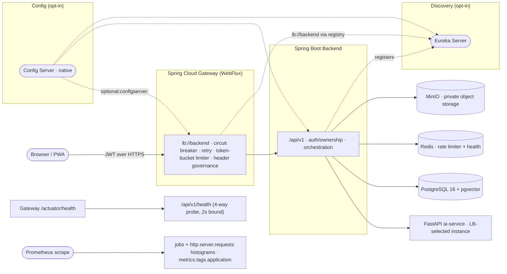

# Microservices & Spring Cloud Architecture

This document describes the Spring Cloud microservices elements integrated into AI Career OS.
The goal is to provide production-oriented service discovery, edge routing, centralized
configuration (opt-in), resilience, and observability while preserving backward compatibility
with existing local/dev and env-driven deployments.

## 1. Components and responsibilities

| Component | Module/Service | Responsibility | Spring Cloud elements |
|---|---|---|---|
| Service Registry | `discovery/` (`career-os-discovery`) | Eureka server; source of truth for registered instances when discovery is enabled | Netflix Eureka Server, Actuator |
| API Gateway / Edge | `gateway/` (`career-os-gateway`) | Single browser-facing edge, routes `/api/**` to backend, request governance and resilience at the edge | Spring Cloud Gateway (WebFlux), CircuitBreaker (Reactor Resilience4j), LoadBalancer, Eureka Client (opt-in), Config Client (opt-in) |
| Domain Backend | `backend/` (`career-os-backend`) | Public API, auth/ownership boundary, orchestration, persistence, bridge to ai-service | Eureka Client (opt-in), Config Client (opt-in), CircuitBreaker Resilience4j (ai-service bridge), LoadBalancer support, Actuator observability |
| Config Server (opt-in) | `config-server/` (`career-os-config-server`) | Centralized externalized configuration via native file/classpath backend | Spring Cloud Config Server (native), Actuator |
| AI Engine | `ai-service/` (FastAPI) | LLM/RAG/agent/interview/feature engines (internal service) | Participates in W3C trace propagation and correlation (request/trace context echoed and logged) |
| Frontend | `frontend/` (Next.js) | User interface; consumes backend API and displays fleet/resilience state in monitoring views | Consumes `/api/v1/system/topology` and `/api/v1/system/resilience` |



Stateful dependencies (PostgreSQL+pgvector, Redis, MinIO) remain shared infrastructure services
as defined in `docker-compose.yml` / `docker-compose.prod.yml`.
A `deploy/k8s/base` Kustomize bundle mirrors the same topology for Kubernetes (namespace, ConfigMap, optional Secret with placeholders only, PersistentVolumeClaims, PDBs for the HTTP-facing deployments); a gate `test_the_k8s_manifests_define_a_working_fleet.py` pins its invariants, and `deploy/k8s/overlays/prod` raises replicas for the three public-facing deployments (Epic 109).

## 2. Service discovery (Eureka, opt-in)

- **Registry**: `discovery` runs a standalone Eureka server (`:8761` by default), dashboard on `/`.
  - Single-node defaults prioritize correctness over preservation: self-preservation disabled and
    faster eviction interval (configurable) so dead instances are removed promptly.
  - Holds no durable data; restart cost is re-registration only.
- **Clients**: `backend` and `gateway` include Eureka client support but are **inert by default**
  (`eureka.client.enabled` / `*_EUREKA_ENABLED` toggles). Enabling the `eureka` profile/flags
  makes registration and (for gateway) registry-backed discovery authoritative.
- **Instance identity & metadata** (for operators and topology clarity):
  - `eureka.instance.instance-id`: `${spring.application.name}:${APP_BUILD_SHA:dev}:${server.port}`
  - `eureka.instance.metadata-map`: `build-sha`, `service`
  - Lease tuning (env-overridable): renewal 10s, expiration 30s on backend/gateway for responsive
    updates in opt-in discovery setups.
- **Topology visibility**: backend exposes authenticated `GET /api/v1/system/topology` (registry mode
  and instances as seen by the backend discovery client), surfaced in the frontend monitoring UI.
- **Two-node peer awareness (Epic 113, opt-in)**: a second registry joins through the `peer` profile
  (`application-peer.yml`), which turns the client ON (`register-with-eureka` + `fetch-registry`) and
  restores self-preservation — with a peer, a network partition is real, and evicting half the fleet
  during one is the failure the protection exists for. Each node's zone names the whole pair (Eureka's
  own peer setup lists every node in each node's zone). Compose: `docker compose --profile app
  --profile cloud up` starts `discovery-peer` (`:8762` loopback) alongside the registry; the main
  discovery learns the pair through `EUREKA_MAIN_PEER_ZONE` (default stays the inert self-zone).
  Kubernetes: the prod overlay ships `discovery-peer.yaml` plus a patch that gives the main discovery
  the pair's zone; contract gate `test_the_k8s_manifests_define_a_working_fleet.py` holds the wiring,
  and `DiscoveryPeerProfileTests` pins what the profile composes. A lone registry is unaffected:
  the default profile keeps the client off (asserted in `DiscoveryApplicationTests`).
- **Load balancing with health-check eviction (108.21)**: the backend's `AiServiceRouter` hands the
  service-id's instance list to Spring Cloud LoadBalancer each call. With
  `spring.cloud.loadbalancer.configurations=health-check` (and `health-check.path.ai-service=/health`),
  the blocking LB evicts an ai-service replica that stops answering its own 2-second-bounded `/health`
  before the circuit breaker has to remember it, and re-adds it when it answers again (`repeat-health-check`).
  If no replica is healthy the router still falls back to the configured first door, so a mis-wired engine
  surfaces as 502 with the ai-service's own sentence instead of an empty route. A contract gate
  (`ai-service/tests/test_the_load_balancer_health_check_stays_on.py`) pins both properties in the backend's
  `application.yml` so this cannot silently drift off.

## 3. API Gateway (Spring Cloud Gateway)

- Edge entrypoint (`gateway`, default `:8081`) routes browser API traffic to the backend via
  `lb://backend` (service-id based routing; compatible with simple instances or Eureka-backed discovery).
- Request governance at the edge includes:
  - CORS alignment with backend and response-header dedupe
  - Forwarded-header handling with trusted proxy boundary
  - Removal/sanitization of sensitive internal headers from browser requests
  - Request size limiting, retry policy for safe/idempotent cases, and circuit-breaker fallback
    behavior for backend unavailability
  - Request/trace correlation propagation (see §6)
- Actuator endpoints exposed per gateway configuration for operations (health/info/gateway/metrics as configured).

## 4. Centralized configuration (Spring Cloud Config, opt-in)

- **Config Server** (`config-server`, default `:8888`, compose profile `config`):
  - Spring Cloud Config Server with **native** backend (`classpath:/config-repo` and mounted `/config`),
    no git dependency.
  - Serves shared and per-service configuration (`application.yml`, `career-os-backend.yml`,
    `career-os-gateway.yml`, `career-os-discovery.yml`) with non-sensitive example knobs.
  - Actuator: `health`, `info`, `env` exposed for operational verification.
- **Clients** (`backend`, `gateway`, `discovery`):
  - Include `spring-cloud-starter-config` but default to **disabled** (`spring.cloud.config.enabled=false`)
    with `spring.config.import=optional:configserver:`.
  - Enable explicitly via environment/config (e.g. `SPRING_CLOUD_CONFIG_ENABLED=true` and Config Server URI);
    `fail-fast` defaults to `false` to preserve startup resilience and existing deployments.
  - A contract gate (`ai-service/tests/test_the_config_client_stays_opt_in.py`) asserts the opt-in
    posture and the config-server's `config` compose profile.
  - Optional shared-secret gate (Epic 114, verified 2026-11-10): set `CONFIG_SERVER_TOKEN` and the
    server requires the matching `X-Config-Token` header on everything except
    `/actuator/health`. `ConfigServerTokenGateTest` covers refusal/admission/wrong-token/health-open.
  - Round-trip (Epic 110, verified 2026-11-10): the `career-os-backend` profile in the
    native repo carries `careeros.extras.demo-property=backend-roundtrip-ok`, so a service
    opted in can read the same value back; `ConfigServerApplicationTests`
    `servesTheBackendRoundTripDemoProperty` pins the round-trip in the offline suite.
**Design constraint**: configuration centralization is additive and opt-in; env-driven and offline
  workflows remain valid defaults.

## 5. Resilience (Resilience4j / Spring Cloud CircuitBreaker)

- **Backend ai-service bridge** is protected by Resilience4j circuit breakers (per-origin and aggregate
  behavior as implemented in `HttpAiServiceClient` / resilience configuration), preventing cascading
  waits when the engine is unavailable and returning fast failures per existing error semantics.
- **Gateway edge** also applies circuit-breaker/retry policies on routed traffic as configured in
  `GatewayResilienceConfig` and the route definitions.
- **Operator visibility**:
  - Authenticated API: `GET /api/v1/system/resilience` reports breaker name, state and key metrics
    (sorted, deployment-wide view) for monitoring/UI and troubleshooting.
  - Authenticated actuator endpoints (backend and gateway): `/actuator/circuitbreakers`,
    `/actuator/circuitbreakerevents` (Spring Cloud/Resilience4j observability), while
    `/actuator/health` and `/actuator/prometheus` remain the public probe/scrape endpoints.
  - Authenticated `/actuator/info` publishes build identity (and backend ai-service breaker shape).
  - Gateway, discovery and config-server expose authenticated `/actuator/prometheus` (Meter registry
    pinned to the offline repository's 1.15.3); they remain behind authentication and are not permitAll.
  - Frontend monitoring page displays topology and resilience cards.

## 5.1 Shared caching & distributed rate limit (Epics 118, 120)

The ai-service stops paying for repeated retrievals: `app/rag/caching.py` keys embeddings by
(provider, model, dim, text) and whole retrieval answers by (reader, epoch, normalised request); a reader's
ingest bumps the epoch so new documents are visible immediately. `app/core/cache.py` carries three backends —
`off` (default), process-local `memory`, or `redis` reached through a small dependency-free RESP2 client
(`app/core/resp.py`). The gateway's rate limiter (`EdgeBudget` family) does the same across replicas:
`InProcessBudget` keeps the current single-process bucket and bounds its identity map; `RedisBudget`
runs one atomic Lua script (HGET/HSET/PEXPIRE) so every replica spends from the same bucket. Errors
fall back to the in-process budget with the `careeros.gateway.ratelimit.fallback` counter and a warning.

## 6. Distributed tracing and correlation

- **W3C trace context propagation** across the request chain:
  - Gateway validates/preserves or mints `traceparent` (and forwards `tracestate` as allowed),
    propagates/echoes correlation headers.
  - Backend propagates/echoes `X-Request-Id` and `traceparent`, records trace context (MDC/logging),
    and forwards to ai-service.
  - ai-service validates/preserves or mints `traceparent`, echoes headers, and emits `trace_id`
    in JSON logs; structured refusal error responses may include optional `requestId`/`traceId`
    for correlation without changing error code/message/status semantics.
- **CORS**: correlation headers are allowed/exposed as required for browser diagnostics.

## 7. Observability and build identity

- **Actuator/health/metrics**:
  - Backend: `/api/v1/health` remains the dependency report contract; `/actuator/health` and
    `/actuator/prometheus` are public probe/scrape endpoints; `/actuator/info` and Resilience4j
    actuator endpoints require authentication.
  - Gateway/Discovery/Config Server expose actuator endpoints appropriate to their role.
  - All four Spring Cloud services enable `management.endpoint.health.probes.enabled=true` (Epic 108.27),
    so Kubernetes-shaped `/actuator/health/liveness` and `/actuator/health/readiness` answers are
    available on every service alongside the public `/actuator/health`.
  - A cross-service contract gate (`test_the_spring_cloud_actuator_surface_contract.py`, Epic 108.20) asserts every
    service exposes `health`, `info` and `prometheus`, and that Breaker-heavy and wiring-debug endpoints
    (`circuitbreakers`/`circuitbreakerevents`/`conditions`) live where the breakers live.
  - The edge carries an optional shared-secret gate for its operations surface: set `GATEWAY_ACTUATOR_TOKEN`
    and every `/actuator/**` needs the `X-Actuator-Token` header (`/actuator/health` stays open for the
    container probe); `GatewayActuatorGuard` refuses at the edge with 403 (`actuator-surface-not-exposed`)
    before the actuator is reached. When unset the surface stays open, as before (compose binds loopback;
    a production proxy must authenticate what it publishes). Runbook: `docs/EDGE_OPERATIONS_LOCKDOWN.md`.
    The edge also carries `/actuator/conditions` behind the same token (Epic 108.16) — the Spring Boot
    condition report, for an operator to see why a wiring bean did or did not match.
    The backend also exposes `/actuator/conditions` for the same Spring Cloud wiring debug (Epic 108.18) —
    behind its existing authentication, not permitAll. Use it to see why the Eureka client or
    circuit breaker did or did not match: a misrouted deployment fails fast there.
- **Build identity**:
  - `APP_BUILD_SHA` is propagated to service `info.app` metadata and Eureka instance metadata/IDs
    where applicable, enabling consistent instance identification across registry, actuator, and health views.
- **Monitoring UI**: fleet topology (with each instance's registry-published build-sha), circuit-breaker state,
  and the engine fleet (one row per ai-service replica the backend's health probe called, Epic 108.23)
  are surfaced in the authenticated monitoring experience.
- **Metrics**: every Spring Cloud service pins `management.metrics.tags.application=${spring.application.name}`,
  so a shared scraper can aggregate `/actuator/prometheus` by application (backend/gateway/discovery/config-server).
  A contract gate (`ai-service/tests/test_the_spring_cloud_services_print_a_common_metrics_tag.py`) enforces it.
  All four services also publish `http.server.requests` latency histograms (108.22) - a second contract gate
  (`ai-service/tests/test_the_spring_cloud_services_publish_latency_histograms.py`) enforces those, so Prometheus
  can compute p50/p95 per application, not only a mean.
  The gateway additionally publishes `spring.cloud.gateway.requests` latency histograms (Epic 111), pinned by the same gate — p50/p95 per route, not just per pod.
  The backend additionally exposes `careeros.circuitbreaker.open` (108.24): an untagged gauge reading 1 while any
  Resilience4j breaker in the ai-service bridge is open, with a bound `CareerOSCircuitBreakerOpen` alarm in
  `ops/prometheus/alerts.yml` and a page in `docs/RUNBOOK.md`.

## 8. CI: every Spring Cloud contract runs on push (Epic 108.26)

The `springcloud` job in `.github/workflows/ci.yml` runs these eleven contract gates on every
push/PR: the actuator surface parity (`…actuator_surface_contract`), config client stays opt-in,
`metrics.tags.application`, latency histograms, `info.app` build-sha shape, the readiness runbook's
sync with `docker-compose.yml`, topology/resilience vocabulary parity, the LB health-check
requirement, the compose files parse, and the alarms gate. The `offline-gate` job waits for
`ai-service`, `frontend`, `backend` and `springcloud` — a gate red blocks the merge. Measured here:
all eleven gates pass (31 tests), workflow YAML structurally valid (not executed on GitHub in this
environment).

## 9. Opt-in enablement summary

| Capability | Default | How to enable |
|---|---|---|
| Eureka registration/discovery | Disabled | Set service-specific `*_EUREKA_ENABLED` / Spring profile `eureka` and configure `EUREKA_DEFAULT_ZONE` (see compose/profile wiring) |
| Eureka two-node peer awareness | Single-node registry | `docker compose --profile app --profile cloud up` (compose) or apply the prod overlay's `discovery-peer.yaml` + zone patch (Kubernetes); see §2 |
| Config Server | Not started | `docker compose --profile config up -d config-server` (or equivalent) |
| Config Client (gateway/discovery/backend) | Disabled | `SPRING_CLOUD_CONFIG_ENABLED=true` and point to Config Server URI/import; keep `fail-fast=false` unless required |
| Resilience actuator endpoints (backend) | Exposed but authenticated | Access with valid credentials/proxy controls; `health`/`prometheus` remain permitAll |
| Trace propagation/correlation | Enabled in request path | No opt-in required; clients/proxies should forward/allow correlation headers |

### 8.1 Runnable opt-in check (no secrets, no live services)

With the `config` profile up, the Config Server serves the shared and per-service examples:

```bash
docker compose --profile config up -d config-server
curl -s http://127.0.0.1:8888/career-os-backend/default    # shared + career-os-backend.yml, must contain `careeros.config-server.service`
curl -s http://127.0.0.1:8888/actuator/health             # {"status":"UP"...}
```

Enable a client the same way (the example is inert by default, so this is opt-in only):

```bash
SPRING_CLOUD_CONFIG_ENABLED=true \
SPRING_CLOUD_CONFIG_URI=http://127.0.0.1:8888 \
< run backend|gateway|discovery as usual >
```

If Config Server is not up, the client keeps the `optional:` import and continues with env-driven
defaults (the contract gate `test_the_config_client_stays_opt_in.py` pins this posture).


## 10. Compatibility and safety notes

- Opt-in features must not break existing env-driven deployments, local development, or offline tests.
- Security boundaries remain unchanged: internal tokens/ownership checks stay enforced, actuator
  exposure beyond probe/scrape endpoints remains authenticated, and no secrets are committed in config examples.
- Verification is performed per batch with targeted offline tests/compiles and compose parse checks
  where relevant; measured results are recorded in `docs/ROADMAP.md` and related docs.
